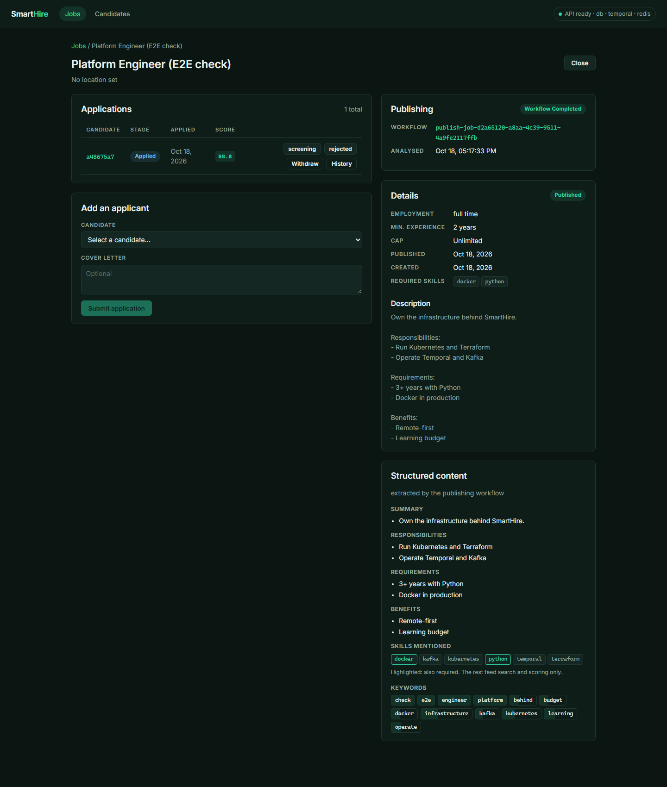
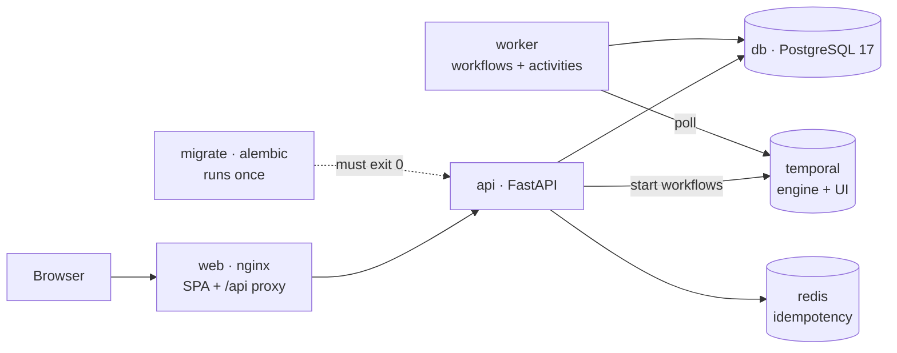

# SmartHire

Intelligent Workforce Orchestration & Recruitment Platform.
**Module 2 — Application Workflow + Publishing Pipeline** (on top of Module 1, Foundation +
Core Services).

Jobs, candidates and applications with the hiring rules enforced in the database
(duplicates, eligibility, limits — correct under concurrency). Publishing runs as a
**Temporal workflow** that extracts skills, keywords and a structured breakdown of the
description, and marks a job ready only when all of it is stored. Each application is
tracked stage by stage, scored, and confirmed exactly once; retried requests are made
safe with **idempotency keys in Redis**.



## Quick start

```bash
cp .env.example .env          # every setting, with defaults — edit as needed
cd frontend && npm install && npm run build && cd ..
docker compose up --build
docker compose run --rm seed  # demo data, including deliberate rule violations
```

| Surface | URL |
|---|---|
| Recruiter console | http://localhost:3000 |
| API | http://localhost:8000 |
| Interactive API docs | http://localhost:8000/docs |
| Temporal UI — every workflow run | http://localhost:8233 |
| PostgreSQL / Redis | localhost:5432 / localhost:6379 |

Every port and setting is configurable — see [.env.example](.env.example).

> The frontend is built on the host rather than inside its image because this network's
> TLS inspection breaks `npm install` in containers. See
> [frontend/README.md](frontend/README.md#known-environment-issues).

## Services



| Service | Role |
|---|---|
| `db` | PostgreSQL — the source of truth; every rule is a constraint or a locked check |
| `migrate` | `alembic upgrade head`, then exits; `api` and `worker` wait for it |
| `api` | FastAPI: validates, enforces rules, starts workflows |
| `worker` | Runs the `PublishJob` and `ProcessApplication` workflows (`app/worker.py`) |
| `temporal` | Workflow engine: records every step, retries, resumes after crashes |
| `redis` | Idempotency records, with expiry |
| `web` | The recruiter console, proxying `/api` |
| `seed` | On demand: `docker compose run --rm seed` |

Temporal or Redis being down degrades the platform rather than stopping it: reads and
applications keep working; publishing waits. See [docs/WORKFLOWS.md](docs/WORKFLOWS.md#5-failure-modes).

## Repository

```
backend/     FastAPI, SQLAlchemy, Alembic, Temporal workers — organised by domain
frontend/    React + TypeScript console, built with Vite
docs/        PRD, architecture, workflows, database, migrations
scripts/     seed.py (demo data via the API), index-benchmark/
```

## Documentation

| Document | Contents |
|---|---|
| [docs/PRD.md](docs/PRD.md) | Use cases, requirements and traceability — Module 1 and Module 2 |
| [docs/ARCHITECTURE.md](docs/ARCHITECTURE.md) | Services, domain packages, 21 design decisions with tradeoffs |
| [docs/WORKFLOWS.md](docs/WORKFLOWS.md) | The two Temporal workflows, every failure mode, how to watch and demo them |
| [docs/DATABASE.md](docs/DATABASE.md) | Normalisation, constraints, indexes with measurements, concurrency |
| [docs/MIGRATIONS.md](docs/MIGRATIONS.md) | How Alembic works here, and the mistakes it caught |
| [backend/README.md](backend/README.md) | API reference, error codes, business rules, tests |
| [frontend/README.md](frontend/README.md) | Vite-over-Next.js rationale, generated API types |

## Tests

```bash
docker compose up -d db temporal redis
cd backend && pytest        # 125 tests: real Postgres, real Temporal, real Redis
ruff check .
cd ../frontend && npm run typecheck
```

Tests needing Temporal or Redis skip with a clear message when those are not running.

## Module roadmap

| Module | Scope | Status |
|---|---|---|
| 1 | Foundation + core services | **Complete** — revised after review |
| 2 | Application workflow + publishing pipeline (Temporal) | **Complete** |
| 3 | Event-driven system (Kafka, outbox, analytics) + observability | Next |
| 4 | Semantic layer — embeddings, vector search | Later |
| 5 | AI assistant — LangGraph, recommendations | Later |

**Known gap:** there is no authentication. Every endpoint is open. It is the subject of
the next review session; the design notes are in
[docs/ARCHITECTURE.md §5](docs/ARCHITECTURE.md#5-gaps).
