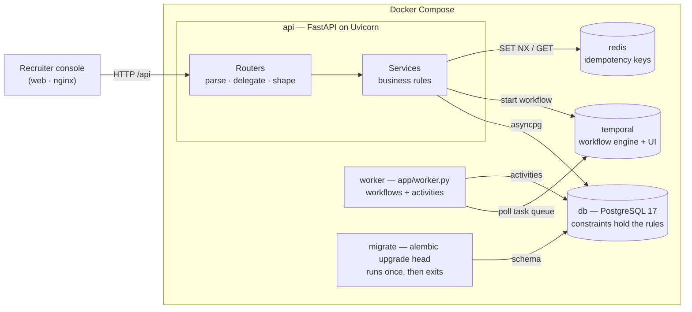
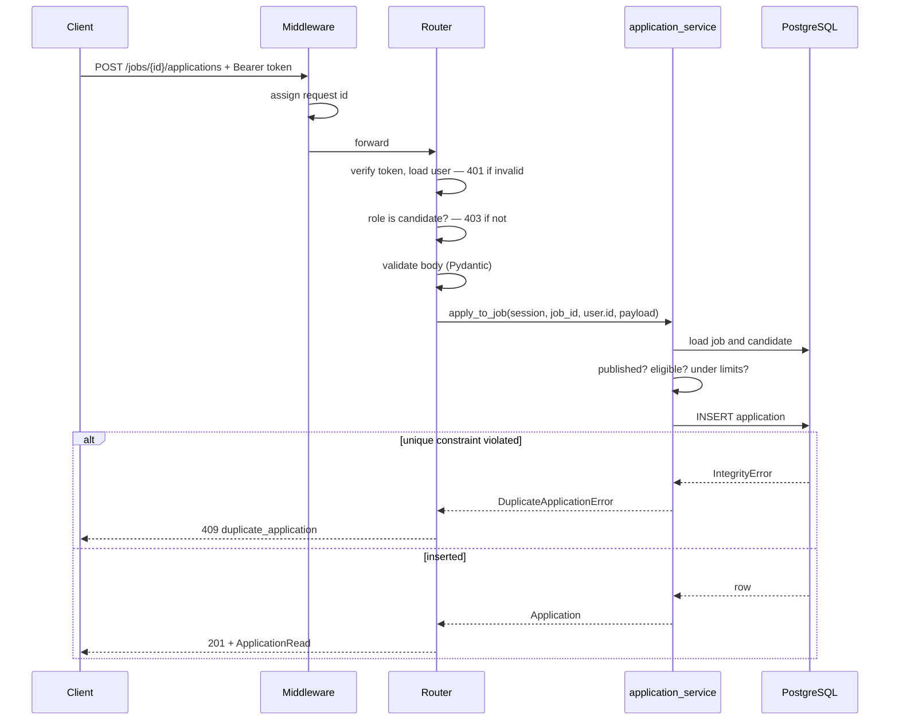
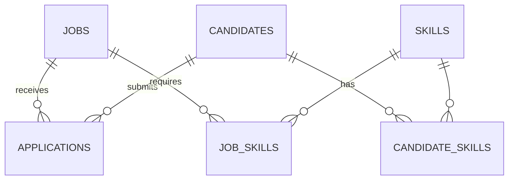

# SmartHire — Architecture and Design Decisions

**Modules 1 and 2** · Module 1: 21 September 2026, revised after its review ·
Module 2 (application workflow + publishing pipeline): 18 October 2026 ·
Authentication (from the Module 1 review): 2 November 2026

This document covers the service breakdown, data and request flow, and — most of all —
the decisions taken, the alternatives rejected, and why. Companion documents:

| Document | Covers |
|---|---|
| [WORKFLOWS.md](WORKFLOWS.md) | The two Temporal workflows, their failure modes, how to watch them |
| [DATABASE.md](DATABASE.md) | Normalisation, constraints, indexes, concurrency |
| [MIGRATIONS.md](MIGRATIONS.md) | How Alembic works here, and the mistakes it caught |

---

## 1. System shape



| Service | Role | If it is down |
|---|---|---|
| `db` | The source of truth. Every business rule is a constraint or a locked check here | Nothing works; readiness 503 |
| `migrate` | Brings the schema to head, then exits 0; the API waits for it | The API does not start |
| `api` | HTTP: validates, enforces rules, starts workflows | — |
| `worker` | Runs workflow and activity code; stateless | Workflows wait, then resume when it returns |
| `temporal` | Records every workflow step, retries, schedules | Publishing answers 503 and changes nothing; applying still succeeds, unscored |
| `redis` | Idempotency records with an expiry | Requests run unprotected; constraints still refuse duplicates |
| `web` | Serves the console, proxies `/api` (re-resolving the API's address) | — |

`db` starts first and must report healthy; `migrate` then brings the schema up to date
and exits; only then do `api` and `worker` start. Neither can run against an outdated
schema.

## 2. Packages and layers

The backend is organised **by domain first, then by layer** — in the spirit of Django
apps. Each domain package holds everything about one part of the business:

```
app/
├── main.py              the app: middleware, error handlers, router table
├── models.py            registry — imports every model for Alembic and the ORM
├── health.py            liveness and readiness probes
├── core/                cross-cutting, knows no domain
│   ├── config.py        every setting, from environment variables
│   ├── db.py            engine and session
│   ├── models.py        Base, naming convention, id and timestamp mixins
│   ├── errors.py        DomainError bases + the one error envelope
│   ├── schemas.py       ReadModel, PatchModel, ErrorResponse
│   ├── pagination.py    Pagination params and Page[T]
│   └── logging.py       request-id logging
├── auth/                models · schemas · service · router · errors · enums
│                        security (hashing, tokens) · dependencies · cli
├── jobs/                models · schemas · service · router · errors · enums
├── candidates/          models · schemas · service · router · errors
├── applications/        models · schemas · service · router · errors · enums
└── skills/              models · schemas · service · router
```

Inside each package the same layers apply:

| Layer | Knows about | Must not know about |
|---|---|---|
| `router.py` | HTTP, status codes, query parameters | Business rules, SQL |
| `service.py` | Business rules, the session, domain errors | HTTP, FastAPI, status codes |
| `models.py` | Tables, columns, constraints | HTTP, Pydantic |
| `schemas.py` | The API contract | Tables |
| `errors.py` | The ways this domain can refuse a request | HTTP beyond a status code |

Dependencies point one way: `applications` uses `jobs` and `candidates`; neither of them
imports `applications`. Every domain router uses `auth.dependencies` to learn who is
calling; `auth` uses no other domain. Everything may use `core`; `core` uses nothing.

The rule that matters: **services raise `DomainError`, never `HTTPException`.** Each
domain declares its own errors (`jobs/errors.py`: `JobNotOpenError`, ...) on bases from
`core/errors.py`, each carrying a status code, and one handler turns any of them into a
response. The payoff is direct — when Module 2 calls a service from a Temporal activity,
there is no HTTP layer to strip out.

### Request flow for an application



## 3. Data model



Jobs, candidates and applications as in Module 1; skills normalised into a `skills`
table with two join tables. Every column, constraint and index — and the reasoning — is
in [DATABASE.md](DATABASE.md).

## 4. Design decisions

### 4.1 Applications are a table, not a foreign key

**Decision.** The candidate–job relationship is its own entity.

**Alternative rejected.** A `job_id` column on candidates, or an array of applied job ids.

**Why.** The relationship carries its own data: which stage it has reached, when it was
submitted, the cover letter, and the match score a later module computes. A foreign key
has nowhere to put any of that. This is the textbook case for a join table with
attributes, and it is also what makes "advance an application" a meaningful operation.

### 4.2 Duplicate prevention lives in the database

**Decision.** A unique constraint on `(job_id, candidate_id)`, plus a service-level
pre-check that exists only for the error message.

**Alternative rejected.** A `SELECT` to check for an existing application, then `INSERT`.

**Why.** The check-then-write pattern is not correct under concurrency. Two requests can
both run the `SELECT`, both see nothing, and both `INSERT` — and the rule the brief asked
for is silently broken under exactly the load the platform is being built to handle. The
constraint is the only thing the database will not let two transactions past.

The pre-check stays because it produces a clear 409 on the common path without burning a
failed transaction. It is an optimisation, not the guarantee — and `test_the_database_itself_refuses_a_duplicate`
bypasses the service entirely to prove which one is load-bearing.

**Tradeoff.** The `IntegrityError` handler needs a `rollback`, and a race produces a
slightly more expensive request. Worth it for a rule that actually holds.

### 4.3 Lifecycle transitions are endpoints, not field edits

**Decision.** `POST /jobs/{id}/publish` rather than `PATCH {"status": "published"}`.

**Why.** Publishing has rules (a closed job cannot be published) and side effects (it sets
`published_at`). A field edit implies neither. It also gives Module 2 an obvious seam:
the Temporal publishing workflow replaces the body of `publish_job` and nothing else moves.

**Tradeoff.** Less RESTful-purist. Named actions for state machines are clearer to both
callers and reviewers.

### 4.4 Separate schemas from models

**Decision.** `schemas/` (Pydantic) and `models/` (SQLAlchemy) are distinct, with three
schemas per resource — `Create`, `Update`, `Read`.

**Alternative rejected.** One shared model, as SQLModel encourages.

**Why.** They answer different questions. `JobCreate` has no `status` field, which is
precisely how a client is prevented from creating an already-published job. `CandidateUpdate`
has no `email`, which is how identity is protected from a casual PATCH. Those omissions
*are* the security model; a shared model cannot express them.

**Tradeoff.** More files and some duplicated field declarations.

### 4.5 Async all the way down

**Decision.** FastAPI, SQLAlchemy async, asyncpg.

**Why.** One blocking call inside `async def` stalls the event loop for every concurrent
request. Mixing a blocking driver into an async stack is the most common way an async
Python service ends up slower than a synchronous one.

**Tradeoff.** Async SQLAlchemy is harder — sessions cannot be shared across tasks, lazy
loading of relationships raises instead of silently querying, and the test suite needs a
single event loop for its connection pool.

### 4.6 Tests run on real PostgreSQL

**Decision.** A `smarthire_test` database, created on demand; its tables are dropped afterwards.

**Alternative rejected.** SQLite in memory.

**Why.** Everything this suite exists to prove is Postgres-specific: the unique constraint
under concurrency, array containment with GIN indexes, native enum types. SQLite either
behaves differently or lacks them. A suite that passes on a database you do not deploy
proves very little.

**Tradeoff.** Tests need Docker running. The fixture skips with a clear instruction
rather than failing cryptically.

### 4.7 One error envelope

**Decision.** Every failure, including FastAPI's own validation errors, returns
`{"error": {"code", "message", "request_id"}}`.

**Why.** A client can branch on a stable `code` rather than pattern-matching prose, and
every response carries the id needed to find the matching server logs. Reshaping
`RequestValidationError` matters most — otherwise the single most common error in the API
is the one with a different shape.

### 4.8 UUID primary keys

**Decision.** UUIDv4, generated in Python.

**Why.** Sequential ids leak business information — `/jobs/1` and `/jobs/2` tell a
competitor how many jobs exist, and let anyone enumerate the table. Generating in Python
means an object has its id before it reaches the database, which simplifies the code that
creates related rows.

**Tradeoff.** 16 bytes rather than 4, and random UUIDs fragment index locality. Irrelevant
at this scale; UUIDv7 is the answer if it ever matters.

### 4.9 Migrations as a separate Compose service

**Decision.** A one-shot `migrate` service that the API waits on via
`service_completed_successfully`.

**Alternative rejected.** Running migrations in the app's startup hook.

**Why.** With N API replicas, a startup-hook migration runs N times concurrently. Making
it a distinct step that must exit 0 means a failed migration stops the deploy rather than
leaving a half-migrated application serving traffic.

### 4.10 Terminal stages do not count toward the limit

**Decision.** `hired`, `rejected` and (since Module 2) `withdrawn` applications are excluded
from a candidate's active count.

**Why.** Otherwise a candidate rejected ten times is permanently locked out of the
platform — a rule that punishes exactly the people who most need to keep applying. The
brief says "application limits" without defining them; this reading is documented rather
than assumed.

### 4.11 Domain packages, not technical layers

**Decision.** `app/jobs/`, `app/candidates/`, ... each holding their own models, schemas,
service, router and errors. Adopted after the Module 1 review.

**Alternative rejected.** The Module 1 layout: `models/`, `schemas/`, `services/`,
`api/routers/`, each holding a file per domain.

**Why.** A change to one feature touched four directories, and every domain's errors
shared one file. Grouping by domain keeps a feature in one place, makes the dependency
direction between domains visible in the imports, and gives Module 2's workflows an
obvious home.

**Tradeoff.** The model registry (`app/models.py`) must import every domain's models, or
Alembic cannot see them. Forgetting one fails loudly in `alembic check`.

### 4.12 Skills are rows, not arrays

**Decision.** A `skills` table with `job_skills` and `candidate_skills` join tables.
**Why.** First normal form, no update anomaly, a real vocabulary. Details and tradeoffs
in [DATABASE.md §2](DATABASE.md#2-normalisation).

### 4.13 Count-then-insert rules use row locks

**Decision.** `apply_to_job` locks the job row, then the candidate row, before counting.

**Alternative rejected.** Serializable isolation for the whole transaction, which would
also prevent the race but turns every conflict into a retryable failure the client must
handle.

**Why.** "At most N rows" cannot be a unique constraint, and without a lock concurrent
requests all count before any commits. A deterministic test reproduced a job capped at 1
accepting 5. See [DATABASE.md §5](DATABASE.md#5-concurrency).

**Tradeoff.** Applications to one job are serialised, for a few milliseconds each.

### 4.14 Configuration comes only from the environment

**Decision.** Every value that differs between environments — hosts, ports, credentials,
pool sizes, business limits — is a field in `core/config.py`, read from an environment
variable and validated at startup. One root `.env` feeds Compose and the backend alike;
`.env.example` lists every variable.

**Why.** The same image must run on a laptop, in CI and in production with nothing but
different variables. A value hard-coded anywhere else is a value someone will forget to
change.

### 4.15 Temporal for publishing, not a task queue

**Decision.** The publishing pipeline is a Temporal workflow (`PublishJobWorkflow`).

**Alternative rejected.** A Celery task, or FastAPI `BackgroundTasks`.

**Why.** Publishing is several dependent steps with a rule about their order — "mark the
job ready only after all processing is complete" — and a requirement that partial
failure must not corrupt it. A task queue runs *one* function and forgets; the steps,
their retries and what-to-do-on-failure would all be hand-written, and a crash mid-way
would leave no record of how far it got. Temporal records every completed step, so a
crashed run resumes rather than restarts, and the whole history is inspectable.
`BackgroundTasks` runs inside the API process and dies with it.

**Tradeoff.** Two more services (server, worker) to run, and a determinism discipline in
workflow code. A one-step fire-and-forget job — sending one email — would not justify
it; Celery stays the right tool for those, in Module 3.

### 4.16 Activities are idempotent; the job flips to ready last

**Decision.** Every activity can run twice with the same effect as once: reads,
a replace-all transaction, and compare-and-set updates (`WHERE status = 'processing'`).
The job becomes `published` only in the final activity.

**Why.** Temporal guarantees *at-least-once* execution of activities: a worker can do the
work and crash before reporting it. Idempotency is what makes "retry" safe. Ordering the
visible state change last means a partial run is never visible to candidates.

### 4.17 Commit, then start, then compensate

**Decision.** `POST /publish` commits `processing`, then starts the workflow; if the start
fails it reverts the status and answers 503. A job left in `processing` by a crash
between the two is healed by publishing again.

**Alternative rejected.** Starting the workflow first (it could run before the status
commits and find a draft), or a distributed transaction (Temporal and Postgres share
none).

**Why.** Two systems, no shared transaction — the "dual write". Ordering plus
compensation is the simplest correct answer at this scale. The transactional outbox,
arriving with Kafka in Module 3, is the general one. The row lock is released before
calling Temporal: a database lock is never held across a network call.

### 4.18 Applying stays synchronous; processing is follow-up work

**Decision.** The application and its first history row are committed in the request;
scoring and the confirmation run afterwards, in `ProcessApplicationWorkflow`.

**Why.** The application is the record the candidate is owed; it must not depend on a
workflow engine being up. The follow-ups may lag or retry. If Temporal is down the
candidate still gets a 201, and `POST /applications/{id}/process` recovers the rest.

### 4.19 Idempotency keys in Redis, failing open

**Decision.** `Idempotency-Key` on every create endpoint; records in Redis with a 24-hour
expiry; claimed with `SET NX`.

**Alternative rejected.** An `idempotency_keys` table in Postgres.

**Why.** Records are small, short-lived and need an atomic claim and an expiry — Redis
does all three natively; Postgres would need a cleanup job. Losing Redis loses only
replays, so it fails open: the database constraints still refuse duplicates. Layered
defence: the key upgrades "refused" to "the original answer"; it is never the only guard.

**Tradeoff.** The response is stored after the commit, not with it. If the process dies
between the two, the claim stays "in progress" until it expires (60 s); a retry after
that runs the action again. For an application or a candidate the database then refuses
the duplicate (409) — correct data, a less friendly answer. **For a job, which has no
natural unique key, the retry creates a second job.** Closing that window means storing
the key in Postgres in the same transaction as the row it protects — the upgrade path if
it ever matters. Only 2xx and 4xx are stored; a 5xx releases the key. Keys are scoped by
endpoint and by user — see §4.25.

The console renews its key once the server has answered: a key belongs to one attempt to
do one thing, and reusing it after a refusal would replay that refusal for a day.

### 4.20 Withdrawal is a stage, history is append-only

**Decision.** `WITHDRAWN` is a terminal stage; `application_stage_changes` records every
move in the same transaction as the move.

**Why.** Module 1's withdraw deleted the row — the one operation that destroyed history.
The brief asks for recovery "without losing application history", and Module 3's
analytics (time to hire, conversion) need the timeline, not just the current stage.

### 4.21 Workflow tests run on a real Temporal server

**Decision.** The API tests run the activities inline (`tests/fakes.py`); separate tests
run the real workflows on the Compose Temporal server with the production worker.

**Why.** Inline runs keep the API tests fast and deterministic; only a real server proves
retries, compensation and non-retryable failures. The SDK's own test server could not be
downloaded behind this network's TLS inspection, so these tests use the Compose server
and skip without it — the same approach as Postgres.

### 4.22 Short-lived JWTs, and refresh tokens that rotate

**Decision.** `POST /auth/login` returns an access token — a JWT signed with HS256, valid
for 15 minutes — and a refresh token: 256 random bits, stored only as a SHA-256 hash in
`refresh_tokens`. Each refresh token works once; `/auth/refresh` revokes it and issues
the next pair. Presenting a token that was already used revokes every session the user
has.

**Alternatives rejected.** Server-side sessions (a session id looked up on every
request); one long-lived JWT; refresh tokens that are themselves JWTs.

**Why.** The access token is verified with no lookup of the token — the signature is
the proof — which keeps the hot path cheap. A JWT cannot be revoked, so it is kept short,
and the revocable part of the session lives in the database where a sign-out can end it.
Rotation turns a stolen refresh token into a detectable event: the thief and the owner
both hold it, and the second to use it presents a revoked token. The server cannot tell
which of them is which, so it ends both sessions; the owner signs in again. The refresh
token is opaque because nothing needs to read it except this table — a JWT would only
add a second way to accept it.

Only a *rotated* token counts as reuse, so `revoked_at` means exactly that. Signing out
deletes the token's row. Ending every session deletes *all* of the user's rows, rotated
ones included: kept, the stolen token could be replayed — through refresh or sign-out,
neither of which needs an access token — to end each session the owner started next.
Issuing and ending a user's tokens both lock the user's row, so a refresh committing
mid-way cannot slip a new token past the deletion. An expired token is refused before the reuse check. Signing out with a
token someone else has already rotated is itself reuse, and ends every session — the
thief's included.

A token presented again within `REFRESH_REUSE_GRACE_SECONDS` (10) of its rotation is
refused but not taken for theft: that is nearly always its own client — a retry after a
lost response, or a page reloaded while its refresh was in flight. The same reuse
interval appears in common identity providers.

**Tradeoffs.** Inside the grace window a thief who rotated first goes undetected if the
owner presents the old token within those seconds; afterwards, detection works as
above. Signing out ends the refresh token, but the access token in hand still works
until it expires — at most 15 minutes. Revoking access tokens too would mean a database
lookup of every token on every request, which is the server-side session this design
avoided. Each request does load the *user* (one primary-key read), so a deleted
account stops working immediately — §4.25.

The algorithm is fixed in code, not read from the token or from settings: a verifier
that trusts the token's `alg` header can be talked into `none`. `JWT_SECRET_KEY` has no
default and must be at least 32 characters — the same rule as the database password.

### 4.23 Argon2id, hashed off the event loop

**Decision.** Passwords are hashed with Argon2id through `pwdlib`, the library FastAPI's
own documentation now recommends. Hashing and verifying run on a thread pool of their
own, `PASSWORD_HASH_WORKERS` (4) threads wide, and sign-in ends its database
transaction before it starts hashing.

**Alternatives rejected.** bcrypt (passlib); a fast hash with a salt.

**Why.** Argon2id is slow and memory-hard on purpose — about 0.1 s and 64 MiB per hash
here — so each guess against a stolen table costs an attacker what a sign-in costs us.
bcrypt is still acceptable, but it is not memory-hard and caps passwords at 72 bytes;
passlib, its usual wrapper, is no longer maintained. That same 0.1 s on the event loop
would stall every other request, which is why it runs in a thread (argon2-cffi releases
the GIL, so the threads hash in parallel). An unknown email still pays for one hash, of
a decoy, so sign-in's timing does not say which emails are registered. Registration
does say it — it must, so a returning user knows to sign in instead — which is why the
decoy is about not adding a second, quieter way to ask, not about hiding the answer.
Hashes made with weaker parameters are upgraded the next time the password is proved.

The pool is separate and bounded because sign-in is the cheapest request to send and
the most expensive to answer. On the event loop's default pool, a burst of sign-ins
would also delay the hostname lookups every new database connection needs; unbounded,
it would take 64 MiB per hash in flight. And a sign-in that held its pooled database
connection through the hash could, fifteen at a time (the default pool and its
overflow), leave no connection for anyone else — so the read is committed first.

### 4.24 A candidate's profile shares its account's primary key

**Decision.** `users` is the account: email, password hash, role.
`candidates.id` is both the primary key of the profile and a foreign key to `users.id`.
The email moved from `candidates` to `users`.

**Alternatives rejected.** A `candidates.user_id` column; keeping an email on both
tables.

**Why.** An email on both tables is the same fact twice, free to disagree — exactly
the redundancy normalisation removes. With a shared key the one-to-one relationship is
enforced by the key itself (a second profile would repeat a primary key), there is no
extra column or index, and ownership is one comparison: an application is yours when
`application.candidate_id == user.id`. Recruiters got a profile of the same shape
later (§4.27).

**Migration.** Existing candidates had no accounts. Revision `d5e8a2f41c07` gives each
one an account with the same id and **no password** — an account that cannot sign in
until a reset flow exists — and only then adds the foreign key. Inventing passwords
would have been worse: nobody would know them.

### 4.25 Secure by default; roles at the boundary; 404 for other people's data

**Decision.** `main.py` mounts every domain router with `get_current_user` as a
router-level dependency. Routes then narrow by role (`RecruiterDep`, `AdminDep`,
`CandidateDep`). Only the health probes, `/auth/register|login|refresh|logout` and the
two invitation endpoints are public, and a test sends a request with no token to every
other operation in the OpenAPI document.

| | Admin | Recruiter | Candidate |
|---|---|---|---|
| Jobs | as a recruiter | everything | read published jobs, and closed ones they applied to (a job reopened as a draft is hidden again, applicants included, until it is republished) |
| Publishing status, extracted content | yes | yes | — |
| Candidates | as a recruiter | read all | read, edit, delete their own |
| Own staff profile (`/recruiters/me`) | read and edit | read and edit | — |
| The hiring team (`/recruiters`) | list, invite, deactivate, reactivate | — | — |
| Apply | — | — | as themselves |
| Applications | as a recruiter | read all, advance, re-process | read their own — without the match score or the recruiter's notes — and withdraw |

**Why.** Protection declared once cannot be forgotten on the next endpoint; protection
added route by route eventually is. Role checks sit in the routers because *who may ask*
is an HTTP-boundary concern, while services keep their domain rules and stay callable
from a Temporal activity. Identity comes from the token, never the body —
`ApplicationCreate` no longer has a `candidate_id`, so nobody can apply as somebody
else. Asking for another candidate's profile or application answers **404**, the same
as for one that does not exist: a 403 would confirm the id is real. So does applying to
a job the candidate could never have seen — a draft, or one mid-publish.

What a candidate reads of their own application is filtered too. The match score ranks
them against other applicants, and a stage-change note is the recruiter's reasoning for
colleagues ("salary expectations too high"): both are left out of the candidate's view.
Every move and its date are shown. Withdrawing is the
candidate's decision and rejecting the recruiter's, so a recruiter cannot set
`withdrawn`.

Idempotency records are keyed by user as well as by key. Unscoped, a second user sending
the same key and body would be answered with the first user's stored response — their
application.

**Tradeoff.** The user is read from the database on every request — one primary-key
lookup — in exchange for deletions and role changes taking effect at once.
`/auth/register` takes no Idempotency-Key: the record stores a hash of the body for a
day, and a fast hash of a password is not something to keep in a cache.

### 4.26 The first admin is created from the command line

**Decision.** Candidates register themselves over HTTP. Staff never do. The first admin
of an installation is created with `python -m app.auth.cli create-admin <email> --name
"<full name>"`, which prompts for the password (or reads it from stdin, for scripts) and
creates the profile with the account. From then on admins add recruiters from the
console (§4.28). `create-recruiter` remains, for scripts and the demo seed, which runs
both before seeding.

**Why.** An HTTP sign-up for staff would let anyone grant themselves every job and
candidate, and the first admin could never be created through an endpoint only admins
may call. Whoever can run a command on the server is already trusted — and it is needed
once per installation, as for Grafana's or GitLab's first administrator. `--exist-ok`
never changes an existing account's role, resets a password or renames anyone.

### 4.27 Recruiters have a profile of their own

**Decision.** A `recruiters` table holds a recruiter's profile: `full_name`, and an
optional `title` (their own role, such as "Talent Partner"). Like `candidates`, its
primary key is also a foreign key to `users.id`. A recruiter reads and edits it at
`/recruiters/me`; it is created with the account, by the CLI.

**Alternatives rejected.** The name on `users`, where candidates would have one twice
(on `users` and on `candidates`) or recruiters a column candidates leave empty; one
`profiles` table with every column, nullable for whichever role does not use it.

**Why.** `users` stays the account and each role keeps its own profile, so the database
can require each role's fields — a NOT NULL `full_name` here, a NOT NULL
`years_experience` on candidates — without one role's columns sitting empty on the
other's rows. A name is the first thing a recruiter needs a profile for: "posted by",
"moved to Interview by".

**Migration.** Recruiter accounts already existed. Revision `45e197ff436b` gives each
one a profile with a name made from its email's local part ("alice.ahmed@…" becomes
"Alice Ahmed"), because `full_name` is required and nobody has supplied the real one.
The recruiter corrects it with `PATCH /recruiters/me`.

**Tradeoff.** Neither profile table checks the account's role, so the database would
accept a recruiter profile on a candidate's account. Only registration and the CLI
create profiles, and each sets the matching role. A composite foreign key on
`(id, role)` would let the database enforce it, at the cost of a `role` column on each
profile.

Admins (§4.28) are staff too, and their profile is a `recruiters` row as well: the
table holds the hiring team, whatever their role on it.

### 4.28 Admins run the hiring team: invitations and deactivation

**Decision.** A third role, `admin`. An admin does everything a recruiter does — every
recruiter check (`require_recruiter`) accepts both — and also manages the team at
`/recruiters`: lists everyone, adds a recruiter, issues a new invitation link, and
deactivates or reactivates people.

- **Adding a recruiter** creates the account and profile with **no password**, plus an
  invitation: 256 random bits, of which `invitations` keeps only a SHA-256, valid for
  `INVITATION_TTL_HOURS` (72). The token is returned once. The console turns it into
  `/invite#<token>` for the admin to send however they like; the recruiter opens it,
  chooses a password (`POST /auth/invitations/accept`) and is signed in. A link works
  once; a new one replaces the old.
- **Deactivating** sets `users.deactivated_at`. Sign-in answers `403 account_deactivated`
  (only after the password is proved, so it reveals nothing to someone guessing);
  `get_current_user` refuses the account's access tokens at once; its refresh tokens and
  invitation links are deleted. Reactivating clears the column. An admin cannot
  deactivate themself.

**Alternatives rejected.**
- *Any recruiter may add recruiters* — then everyone with access can hand out access,
  and the company loses control of who sees every candidate.
- *The admin types a temporary password* — the admin then knows it, and it travels in
  chat. With a link, nobody but the recruiter ever knows their password.
- *Email the link from the server* — the project has no email channel yet; the admin
  sends it instead. When one exists, the same token goes in the email.
- *Delete leavers* — their name would vanish from what they did, and a mistake could not
  be undone.

**Why the token travels as it does.** In the request body, never the URL, so it stays
out of server and proxy logs; after a `#` in the console's link, which browsers never
send to a server. Like a refresh token, a fast hash is right: the token cannot be guessed.

**Concurrency.** The team always keeps an admin. An admin cannot deactivate themself,
and every team change takes one advisory lock (`pg_advisory_xact_lock`) and re-reads the
acting admin under it: of two admins deactivating each other at once, the second finds
its admin already deactivated and is refused (`account_deactivated`). Every path that
changes an account's access locks its rows in one order — refresh tokens, invitations,
then the user (`auth.service.lock_account`) — so deactivating cannot deadlock with a
refresh or an accepted invitation; a test reproduces the deadlock the old order caused.
Sign-in re-reads the account under the user's lock after the password hash, so a
deactivation during that tenth of a second leaves no refresh token behind.

**Tradeoff.** An admin can deactivate another admin. Roles cannot be changed from the
console — promoting a recruiter to admin is a later feature. No rate limit on the
public invitation endpoints (see Gaps).

## 5. Gaps

| Gap | Status / where it belongs |
|---|---|
| ~~**No authentication** — every endpoint is open~~ | Fixed after review — §4.22–4.26 |
| ~~Recruiters could only be added from the server's command line~~ | Fixed — admins invite them from the console (§4.28) |
| Roles cannot be changed from the console (promote a recruiter to admin) | A later admin feature; the CLI creates admins today |
| ~~No way to change a password~~ | Fixed — `POST /auth/change-password` needs the current password, ends every session, returns a new pair |
| No password reset ("forgot password") or email verification; pre-auth candidates cannot sign in | Needs an email channel — Module 3; the notifications table is the seam |
| An access token outlives sign-out by up to 15 minutes | By design (§4.22); a deny-list in Redis if it ever matters |
| Used and expired refresh tokens accumulate | A periodic purge of rows past `expires_at` |
| The console holds the refresh token where script on the page could read it | An httpOnly cookie — [frontend/README.md](../frontend/README.md#authentication) |
| No limit on accounts probing registration for taken emails | Rate limiting (below); registration must answer "taken" to be usable |
| ~~Publishing is synchronous, no skill extraction~~ | Module 2 — `PublishJobWorkflow` |
| ~~`match_score` is always null~~ | Module 2 — `ProcessApplicationWorkflow`, rule-based score |
| ~~Withdrawing deletes the application~~ | Module 2 — `withdrawn` stage + history |
| ~~Retried creates duplicate or mis-report~~ | Module 2 — Idempotency-Key |
| No events emitted on publish or apply; no analytics | Module 3 — Kafka, consumers, the transactional outbox |
| Exact-string skill matching | Module 4 — embeddings and semantic search |
| Logs only; no metrics or traces | Module 3 — OpenTelemetry. The request id is the seam |
| Offset pagination drifts under concurrent inserts | Keyset pagination when volume demands it |
| ~~Unindexed search, redundant indexes~~ | Fixed after review — [DATABASE.md §4](DATABASE.md#4-indexes) |
| ~~Count-then-insert race on application limits~~ | Fixed after review — row locks |
| No rate limiting — including sign-in attempts | Before any public exposure; Argon2's cost slows guessing but does not cap it |
