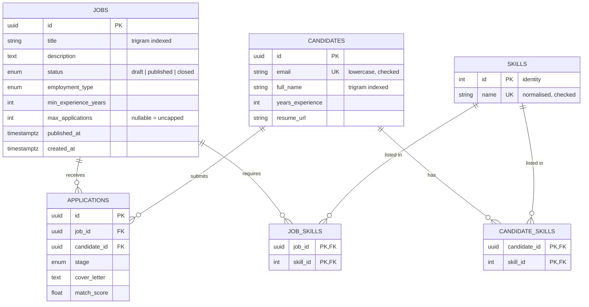

# SmartHire — Database Design

How the PostgreSQL schema is shaped, and why: normalisation, constraints, indexes, and
how concurrent writes are kept correct. The migration mechanics are in
[MIGRATIONS.md](MIGRATIONS.md).

---

## 1. Schema



## 2. Normalisation

Normalisation is the discipline of storing each fact exactly once, so that it cannot be
updated in one place and left stale in another.

| Form | The rule | How this schema meets it |
|---|---|---|
| 1NF | Every column holds one atomic value; no lists, no repeating groups | Skills moved out of array columns into rows (§2.1) |
| 2NF | No column depends on only *part* of a composite key | The only composite keys are the two join tables, which have no other columns |
| 3NF | No column depends on another non-key column | No derived or copied data: an application stores `job_id`, never the job's title |

### 2.1 Skills: from arrays to a lookup table

Module 1 stored skills as Postgres arrays: `jobs.required_skills text[]` and
`candidates.skills text[]`. Practical and fast — but a list in a column breaks 1NF, and
the schema showed the classic symptoms:

| Problem | With arrays | With `skills` + join tables |
|---|---|---|
| **Update anomaly** — rename "postgres" to "postgresql" | Rewrite every array containing it, on two tables. Miss one and the vocabulary splits | Update one row in `skills` |
| **No vocabulary** — which skills exist? | `SELECT DISTINCT unnest(...)` over both tables, every time | `SELECT name FROM skills` — and `GET /skills` |
| **Facts about the link** — "required vs nice-to-have", a candidate's years with one skill | Nowhere to put them | A column on the join table |
| **Matching a description to skills** (Module 2's extractor) | Nothing to match against | Match against `skills.name` |

Each skill is now one row in `skills`; `job_skills` and `candidate_skills` record which
job requires, and which candidate has, which skill.

**Design choices in the new tables:**

- `skills.id` is an integer identity, not a UUID. It is a lookup table, joined on
  constantly; UUIDs on jobs and candidates exist to stop enumeration of business data,
  and a skill name is not sensitive. `GENERATED ALWAYS` refuses client-supplied ids.
- `skills.name` has a unique constraint *and* a check constraint
  (`name = lower(btrim(name))`). The API normalises names, but the database guarantees
  it — so "Python" can never sit beside "python" as a second row, whoever writes.
- Join tables have a composite primary key `(owner_id, skill_id)`: one link per pair,
  enforced. Foreign keys `CASCADE` from the owner (delete a job, its links go) and
  `RESTRICT` from the skill (a skill in use cannot be deleted).
- Skills are created implicitly with `INSERT ... ON CONFLICT DO NOTHING`, which is safe
  when two requests introduce the same new skill at once. A `SELECT`-then-`INSERT` races.

**What did not change:** the API. Jobs still expose `required_skills: string[]` and
candidates `skills: string[]`; the model translates. The frontend needed no change.
The one visible difference is ordering — skills now come back alphabetically.

**Tradeoff.** Reading a job now needs a join, where the array came free with the row.
The ORM loads skills for a whole result page with a single extra
`WHERE job_id IN (...)` query (`lazy="selectin"`), so a page of 20 jobs costs two
queries, not twenty-one.

### 2.2 What was deliberately not normalised

- **`department` and `location`** stay free-text columns. There is no business rule
  attached to either yet; a lookup table would add joins and an admin screen for no
  gain. If departments ever get budgets or owners, they become a table then.
- **Enums** (`status`, `stage`, `employment_type`) stay native Postgres enums. They are
  closed sets owned by the code, not data owned by users.

## 3. Constraints

The database refuses invalid data itself, whichever client wrote it.

| Constraint | Guarantees |
|---|---|
| `uq_applications_job_candidate` | A candidate applies to a job at most once — holds under concurrency |
| `uq_candidates_email` + `ck_candidates_email_lowercase` | One account per address, case-insensitively |
| `uq_skills_name` + `ck_skills_name_normalised` | One row per skill |
| `ck_jobs_min_experience_non_negative`, `ck_candidates_years_experience_non_negative` | No negative experience |
| `ck_jobs_max_applications_positive` | A cap, if set, is at least 1 |
| Foreign keys | No application or skill link points at a missing row |

Every constraint and index follows one naming convention (`pk_`, `fk_`, `uq_`, `ck_`,
`ix_`), declared on `Base.metadata`. Predictable names are what let a migration drop or
alter a constraint reliably — see [MIGRATIONS.md §5](MIGRATIONS.md#5-naming-conventions).

## 4. Indexes

An index is a sorted copy of some columns, pointing back at the rows. It makes the reads
that match its shape fast, and makes every write to the table slightly slower — so each
one must earn its place. Module 1 indexed columns one at a time; they are now designed
around the queries the services actually run.

| Index | Serves |
|---|---|
| `ix_jobs_status_created_at` | `WHERE status = ? ORDER BY created_at DESC LIMIT 20` — candidates browsing open jobs, the hottest query |
| `ix_jobs_created_at` | The same listing with no status filter |
| `ix_jobs_title_trgm` (GIN, pg_trgm) | `title ILIKE '%term%'` |
| `ix_candidates_created_at` | Candidate listing, newest first |
| `ix_candidates_full_name_trgm` (GIN, pg_trgm) | `full_name ILIKE '%term%'` |
| `uq_applications_job_candidate` | The duplicate rule, and every lookup by `job_id` (its leading column) |
| `ix_applications_candidate_id_stage` | The active-application count, run on every apply |
| `ix_applications_job_id_created_at` | A job's applications, newest first |
| `ix_job_skills_skill_id`, `ix_candidate_skills_skill_id` | "Which jobs need kafka?" — the primary keys only serve lookups by owner |

### 4.1 What changed, and why

| Module 1 index | Problem | Now |
|---|---|---|
| `ix_jobs_title` (B-tree) | A B-tree matches known *prefixes*. `ILIKE '%engineer%'` starts with a wildcard, so the index could never be used | Trigram GIN index: matches any substring of 3+ characters |
| `ix_jobs_status` | Served the filter but not the sort: to find the newest 20 published jobs, Postgres fetched all of them and sorted | `(status, created_at)`: walks the published slice backwards and stops after 20 |
| `ix_applications_job_id` | Duplicated the unique index on `(job_id, candidate_id)`, whose leading column already serves `job_id` | Dropped |
| `ix_applications_candidate_id` | Served half of the active-count query | `(candidate_id, stage)` serves all of it |
| `ix_applications_stage` | Six distinct values: any one stage is a large slice of the table, so the planner prefers a sequential scan | Dropped |

### 4.2 Measured

20,000 jobs, 50,000 candidates, 305,000 applications (one "hot" job holding 5,000),
`EXPLAIN ANALYZE` before and after migration `e91a6c3f0b58`. Reproduce with
[scripts/index-benchmark](../scripts/index-benchmark/README.md).

| Query | Before | After | |
|---|---|---|---|
| Browse published jobs, newest 20 | Seq scan, 14,000 rows, sort — **5.25 ms** | Backward index scan, 20 rows — **0.14 ms** | 37× |
| Job title search | Seq scan, 20,000 rows — **15.9 ms** | Trigram bitmap scan — **3.5 ms** | 4.5× |
| Candidate name search | Seq scan, 50,000 rows — **34.1 ms** | Trigram bitmap scan — **6.4 ms** | 5.3× |
| Hot job, newest 20 applications | 5,014 rows fetched, then sorted — **1.34 ms** | Backward index scan, 20 rows — **0.09 ms** | 15× |
| Active applications for a candidate | Index on `candidate_id` — 0.14 ms | Index on `(candidate_id, stage)` — 0.10 ms | ≈ |

The wins grow with the table: a sequential scan is linear in the row count; an index
scan that stops after 20 entries is not.

On the write side, `applications` — the most write-heavy table — went from five indexes
to four, so every insert maintains one fewer.

## 5. Concurrency

Constraints cover the rules that can be phrased as "unique". Two rules cannot:

- a candidate may hold at most N active applications;
- a job may accept at most `max_applications`.

Both are *count, then insert*. Run concurrently, every request can count before any of
them commits, and all of them pass. `tests/test_applications.py` reproduces it
deterministically: before the fix, a job capped at 1 accepted 5 applications.

The fix is a row lock. `apply_to_job` locks the job row, then the candidate row
(`SELECT ... FOR NO KEY UPDATE`), and holds both until it commits. A competing
application waits at the lock, then counts the row the first one inserted.

- **Lock order is fixed** — job, then candidate — on every path. Two transactions that
  take the same two locks in opposite orders can each hold one and wait for the other:
  a deadlock.
- **`FOR NO KEY UPDATE`**, not `FOR UPDATE`: it excludes other appliers, but does not
  block unrelated inserts that merely reference the row through a foreign key.
- **Cost:** applications to one job are serialised. Each holds the lock for a few
  milliseconds, so one job still takes hundreds per second. Uncapped jobs could skip
  the job lock if that ever matters.

`advance_stage` locks the application row for the same reason: two recruiters moving one
application at once would otherwise both read the old stage, and the second write would
silently discard the first.

## 6. Writes and round trips

Every model with timestamps sets `eager_defaults`, so the database-generated
`created_at` / `updated_at` come back in the same statement that writes the row:

```sql
INSERT INTO jobs (...) VALUES (...) RETURNING jobs.created_at, jobs.updated_at
UPDATE jobs SET title = $1, updated_at = now() WHERE jobs.id = $2 RETURNING jobs.updated_at
```

Module 1 followed each commit with `session.refresh()` — a second round trip — to read
them. Each service function is one transaction: it commits once, at the end, or rolls
back entirely.
