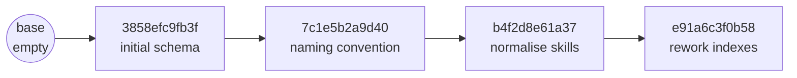
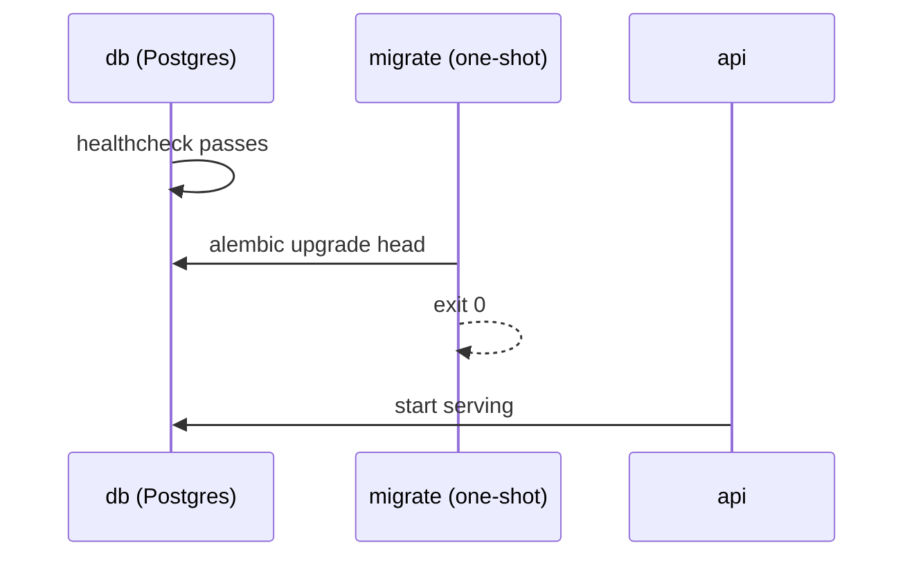

# SmartHire — How Migrations Work

A guide to Alembic as this project uses it: what a migration is, how Alembic decides
what to run, what autogenerate can and cannot do, and the mistakes this project actually
made and fixed. The schema itself is described in [DATABASE.md](DATABASE.md).

---

## 1. What a migration is

The models in `app/*/models.py` describe the schema the code *expects*. The database
holds the schema that *exists*. A migration is a script that moves a database from one
schema version to the next, and back.

Each one is a Python file in `backend/migrations/versions/` with two functions:

```python
revision = "b4f2d8e61a37"          # this file's id
down_revision = "7c1e5b2a9d40"     # the revision it builds on

def upgrade() -> None: ...         # move forward one step
def downgrade() -> None: ...       # undo exactly that step
```

`down_revision` links each file to its parent, so the files form a chain:



The **order comes from that chain, never from file names.** File names are
date-prefixed only so the folder reads chronologically.

## 2. How Alembic knows what to run

The database records its own version in a one-row table:

```sql
SELECT * FROM alembic_version;   -- e91a6c3f0b58
```

`alembic upgrade head` reads that row, walks the chain from there to the newest revision
(`head`), runs each `upgrade()` in order, and updates the row after each one. A database
already at head runs nothing, which is why `migrate` can run on every
`docker compose up`.

On PostgreSQL each revision runs **inside a transaction**. If any statement fails, that
revision rolls back entirely and `alembic_version` still names the previous one — the
database is never left half-migrated.

## 3. How it runs in this project



`migrate` is its own Compose service, using the same image as the API. The API starts
only after it exits 0 (`service_completed_successfully`). Two reasons:

- **A failed migration stops the deploy**, instead of leaving an API serving against a
  schema it does not match.
- **It runs once.** In an API startup hook it would run once per replica, concurrently.

`migrations/env.py` takes the connection URL from `app.core.config.settings` — the same
source as the application — so migrations cannot target a different database than the
app. Tests may pass their own URL through `config.attributes["database_url"]`.

## 4. Autogenerate — what it sees, and what it misses

```bash
alembic revision --autogenerate -m "describe the change"
```

compares `Base.metadata` (every model, imported through `app/models.py`) with the live
database and writes the difference as a draft migration. **It is a draft.** Read every
line before committing it.

| Autogenerate detects | Autogenerate misses |
|---|---|
| Tables and columns added or removed | **Data.** It never moves rows — see §6 |
| Column type and nullability changes | A **rename**: it sees a drop plus an add, and the data is lost |
| Indexes, unique and foreign-key constraints | **Enum values** added to an existing Postgres enum |
| Server defaults (enabled in env.py) | **`DROP TYPE`** for enums created by `create_table` — see §7.1 |
| | Check constraint *changes*, extensions (`pg_trgm`), triggers |

`alembic check` runs the same comparison and fails if there is any difference. It is the
quickest way to prove the models and the migrations agree.

## 5. Naming conventions

If a constraint has no explicit name, **Postgres invents one** (`jobs_pkey`,
`candidates_email_key`, `applications_job_id_fkey`). A later migration that must drop it
has to know that invented name — and other databases may have invented differently.

So `Base.metadata` declares a convention:

```python
NAMING_CONVENTION = {
    "pk": "pk_%(table_name)s",
    "fk": "fk_%(table_name)s_%(column_0_name)s_%(referred_table_name)s",
    "uq": "uq_%(table_name)s_%(column_0_name)s",
    "ck": "ck_%(table_name)s_%(constraint_name)s",
    "ix": "ix_%(column_0_label)s",
}
```

This project adopted it late — after the initial schema — so revision `7c1e5b2a9d40`
renames the six constraints Postgres had named itself.

**`op.f()`** marks a name as already final. Inside a migration, Alembic applies the
convention to names you pass it; `op.f("ck_candidates_email_lowercase")` tells it not to
apply it again (§7.3 is what happens without it).

## 6. Data migrations

Revision `b4f2d8e61a37` replaced two array columns with join tables. Autogenerate
produced only half of it — create the tables, drop the columns. Run as generated, it
would have **deleted every skill in the database**, silently.

The hand-written half moves the data while both shapes exist:

```text
upgrade():   1. create skills, job_skills, candidate_skills   (arrays still exist)
             2. INSERT ... SELECT unnest(...)                 (both exist — copy across)
             3. drop the array columns
downgrade(): the same three steps in reverse, rebuilding each array from the join table
```

The rule: **when the shape of data changes, write the copy step yourself, and make the
downgrade copy it back.** `test_skills_data_migration_preserves_every_skill` proves both
directions.

## 7. Mistakes found while studying this — and their fixes

All three were invisible to the normal test suite, which builds its schema with
`metadata.create_all()` and never runs a migration. They surfaced by migrating a
database down to `base` and back up.

### 7.1 A downgrade that left objects behind

The initial revision's autogenerated `downgrade()` dropped the tables but not the three
enum types `create_table()` had created implicitly. After `alembic downgrade base`, the
next `upgrade` failed:

```
type "employment_type" already exists
```

**Fix:** `DROP TYPE IF EXISTS` for each enum, added to that `downgrade()`.

### 7.2 History that depended on today's models

Alembic builds migration objects with the naming convention of the **current**
`Base.metadata`. Once the convention existed, replaying the *initial* revision on an
empty database produced `pk_jobs` instead of `jobs_pkey` — so the rename revision
failed on fresh databases, and fresh and existing databases would have diverged.

**Fix:** every constraint name in the initial revision is pinned with `op.f()`, so
history replays exactly as it first ran.

> **Never edit the `upgrade()` of a revision that has been applied** — databases that
> already ran it will not run it again, and will silently differ. Both fixes above are
> safe because they change only `downgrade()`, or only names that make a fresh database
> come out identical to an existing one.

### 7.3 A name prefixed twice

`op.drop_constraint("ck_candidates_email_lowercase", ...)` looked for
`ck_candidates_ck_candidates_email_lowercase`: Alembic applied the `ck` convention to a
name that already had it. **Fix:** `op.f(...)`.

### 7.4 The test that now guards all of this

`tests/test_migrations.py` runs against a scratch database, created and dropped per test:

| Test | Catches |
|---|---|
| `test_upgrade_from_empty_matches_the_models` | A model change without a migration (`alembic check` after a full upgrade) |
| `test_downgrade_to_base_removes_everything` | §7.1 and §7.2 — leftovers, and history that cannot replay |
| `test_skills_data_migration_preserves_every_skill` | A data migration that loses rows, in either direction |

## 8. Production concerns

Not needed at this project's size, but the questions a reviewer will ask:

- **Locks.** `CREATE INDEX` blocks writes to the table while it builds. On a large live
  table use `CREATE INDEX CONCURRENTLY`, which cannot run in a transaction — in Alembic,
  inside `with op.get_context().autocommit_block():`.
- **Zero-downtime changes: expand, then contract.** Renaming a column in one step breaks
  every running replica still using the old name. Instead: add the new column and write
  both (*expand*), deploy code that reads the new one, backfill, then drop the old column
  in a later release (*contract*).
- **Adding an enum value** needs `ALTER TYPE ... ADD VALUE`, written by hand; removing
  one means recreating the type.
- **Review the SQL before it runs:** `alembic upgrade head --sql` prints it without
  touching a database (offline mode).

## 9. Commands

Run from `backend/` with the virtualenv active.

```bash
alembic current                      # the database's revision
alembic history --verbose            # the chain
alembic upgrade head                 # apply everything outstanding
alembic downgrade -1                 # undo the last revision
alembic upgrade head --sql           # print the SQL instead of running it
alembic check                        # fail if models and database differ
alembic revision --autogenerate -m "add x to y"   # draft a migration — then read it
pytest tests/test_migrations.py      # replay history against a scratch database
```

Inside Compose, migrations run automatically; to run one by hand:

```bash
docker compose run --rm migrate alembic current
```
