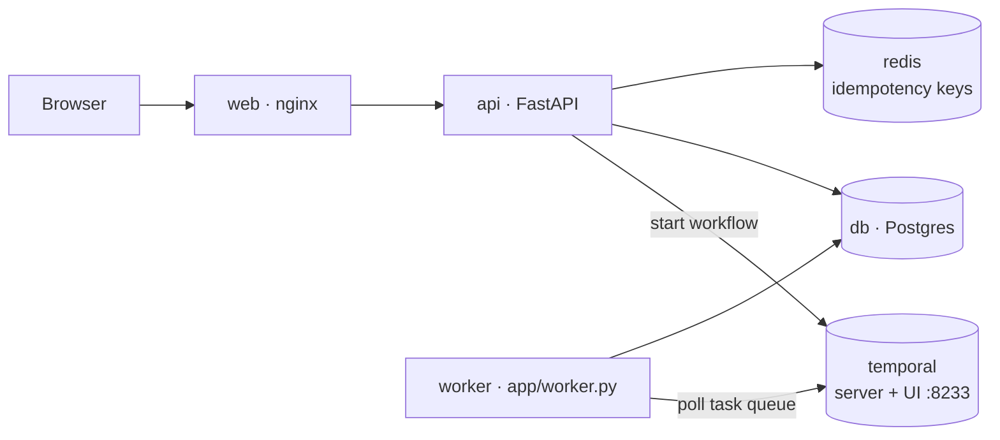
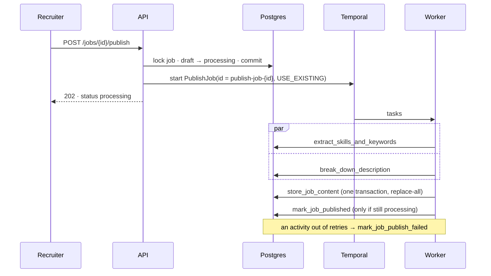
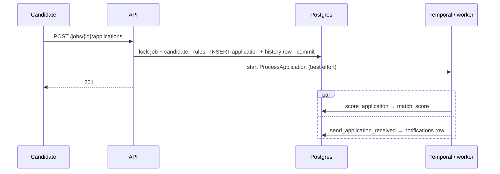

# SmartHire — Workflows

**Module 2: Application Workflow + Publishing Pipeline** · 18 October 2026

How SmartHire runs its two background workflows on Temporal, and how each one stays
correct when something fails halfway. The data model behind them is in
[DATABASE.md](DATABASE.md); the overall shape in [ARCHITECTURE.md](ARCHITECTURE.md).

---

## 1. Why a workflow engine

Publishing a job is four steps: extract skills and keywords, break the description into
parts, store the result, mark the job ready. Done inside the HTTP request, any failure
between steps leaves a half-published job, a crash loses the work in flight, and a slow
step holds the recruiter's browser open.

Temporal turns those steps into a **durable workflow**: the server records the result of
every completed step, retries failed steps with backoff, and if a worker dies, another
replays the record and resumes from the next step. The API only *starts* the workflow and
answers `202 Accepted`.

| Without Temporal | With Temporal |
|---|---|
| Hand-written retry loops around every call | One retry policy per workflow, declared once |
| Crash mid-way = lost work, inconsistent state | Crash mid-way = resume from the last completed step |
| "Is it running? Did it fail? Why?" — grep logs | Every run, input, attempt and error browsable at http://localhost:8233 |
| Two clicks start two runs | One workflow id per job: the second click attaches to the first run |

### The vocabulary

| Term | Meaning here |
|---|---|
| **Workflow** | The orchestration: which steps, in what order, what to do on failure. `PublishJobWorkflow`, `ProcessApplicationWorkflow`. Must be deterministic. |
| **Activity** | One step that does real work — here, database reads and writes. May fail; is retried; runs **at least once**. |
| **Worker** | The process that runs workflow and activity code (`app/worker.py`, Compose service `worker`). Stateless: kill it and nothing is lost. |
| **Task queue** | The named queue (`smarthire`) the server puts tasks on and workers poll. |
| **Workflow id** | A business-meaningful id (`publish-job-<job id>`). Temporal allows one *running* workflow per id. |
| **History** | The server's record of every event in a run. Replaying it rebuilds the workflow's state after a crash. |

## 2. Topology



The API and the worker are the same image running different commands. Neither talks to
the other: they meet only through Temporal and Postgres.

## 3. PublishJob



| Step | Does | Idempotent because |
|---|---|---|
| `extract_skills_and_keywords` | Matches the text against the skill vocabulary; ranks keywords | Read-only |
| `break_down_description` | Splits into summary / responsibilities / requirements / benefits | Read-only |
| `store_job_content` | Replaces the job's sections, keywords and extracted skills | Delete-then-insert in **one transaction**: all or nothing, same result every run |
| `mark_job_published` | `processing → published`, sets `published_at` | Compare-and-set: `UPDATE ... WHERE status = 'processing'` — a second run changes nothing |
| `mark_job_publish_failed` | `processing → publish_failed` + reason | Same compare-and-set |

**Retries:** 1 s, 2 s, 4 s, 8 s ... capped at 20 s, up to `PUBLISHING_MAX_ATTEMPTS` (5)
per activity. A deleted job raises a *non-retryable* error and fails at once.

**The analysis itself** (`app/publishing/content.py`) is pure functions — strings in,
data out — so it is deterministic, unit-tested in milliseconds, and explainable line by
line. Module 4 replaces spelling-matching with embeddings behind the same activities.

### Updates

Editing the title, description or required skills of a *published* job starts the same
workflow with the `TERMINATE_EXISTING` conflict policy (`restart=True`): the newest
edit wins, and the job **stays published** throughout. A job that is `processing` cannot be
edited — the workflow is reading that text.

## 4. ProcessApplication



The application is **never part of the workflow**. It is committed in the request, so it
is safe the moment the 201 is sent; scoring and the confirmation are follow-up work that
may lag, retry or fail without touching it.

- **Scoring** (`app/applications/scoring.py`): required skills 60%, experience 25%, other
  skills the description mentions 15% — using the publishing workflow's extracted skills.
  Scores rank candidates within one job.
- **Notification**: a row in `notifications` with a unique `dedupe_key`
  (`application_received:<id>`), inserted with `ON CONFLICT DO NOTHING`. Activities run
  at least once; this turns a second run into a no-op, so a candidate never gets two
  emails. Delivery is simulated (logged); a real provider would receive the same key as
  its own idempotency key.
- **Analytics** updates are Module 3's: Kafka consumers of application events.

## 5. Failure modes

Every row was tested, most of them against the real stack.

| What fails | What happens | Where it is proven |
|---|---|---|
| An activity, transiently | Retried with backoff; the recruiter never sees it | `test_transient_failures_are_retried_until_they_succeed` |
| An activity, every attempt | Compensation: job → `publish_failed` + reason; run marked Failed | `test_exhausted_retries_mark_the_job_failed`; live with `PUBLISHING_FAULT_RATE=1` |
| The worker, mid-publish | Job waits in `processing`; a restarted worker resumes and finishes | Live: worker stopped, publish, worker started → published in ~4 s |
| Temporal, when publishing | Status change reverted; `503 workflow_unavailable`; nothing half-done | `test_engine_outage_changes_nothing` |
| Temporal, when applying | Application still `201`; unscored; `POST /applications/{id}/process` recovers | `test_an_engine_outage_does_not_fail_the_application` |
| A job closed mid-publish | Stays closed: the final step only leaves `processing` | `test_closing_mid_publish_is_not_undone_by_the_workflow` |
| A double-clicked Publish | One run: the second start attaches (`USE_EXISTING`) | `test_publishing_a_processing_job_starts_again_rather_than_twice` |
| A retried apply / create | Original response replayed (Idempotency-Key, Redis) | `tests/test_idempotency.py` |
| Redis | Requests run unprotected; database constraints still refuse duplicates | `test_redis_down_fails_open` |
| The notification activity, twice | One row, one email | `test_workflow_scores_and_confirms_exactly_once` |

### The dual write

Publishing writes to two systems with no shared transaction: Postgres
(`draft → processing`) and Temporal (start the workflow). Either can fail after the other
succeeded. SmartHire orders and compensates:

1. Commit the status first, so the workflow always finds the job in `processing`.
2. If the start fails, put the status back and answer 503.
3. If the process dies between the two, the job is left in `processing` with nothing
   running — and publishing it again restarts the workflow (`USE_EXISTING` finds no run
   and starts one). The stuck state heals on the next click.

The general solution is the **transactional outbox**: write the intent to a table in the
same transaction, and have a relay deliver it. Module 3 brings it in with Kafka.

## 6. Determinism

Temporal rebuilds a workflow after a crash by replaying its history through the workflow
code. A replay must make the same decisions in the same order, so workflow code may not:
read the clock, generate random numbers, do I/O, or read configuration. Everything
variable arrives in the input — which is why `max_attempts` is a field of
`PublishJobInput` rather than a setting read inside the workflow.

Activities have no such rule; that is exactly why all real work lives in them.

## 7. Watching it run

| Where | What |
|---|---|
| http://localhost:8233 | Temporal UI: every run, its input, history, attempts and errors |
| `GET /jobs/{id}/publication` | Job status + workflow status + live step (a Temporal *query*) |
| `GET /jobs/{id}/content` | What was extracted |
| `GET /applications/{id}/history` | Every stage change |
| `GET /applications/{id}/notifications` | Every message sent |
| `docker compose logs -f worker` | `job_content_stored`, `application_scored`, `notification_sent` |

### Demo: retries and failure

```bash
# Every activity attempt fails: watch the retries in the UI, then publish_failed.
docker compose stop worker
docker compose run -d --rm --no-deps -e PUBLISHING_FAULT_RATE=1 --name worker-faulty worker
# ... publish a job in the console ...
docker stop worker-faulty && docker compose start worker   # then Retry publishing

# Half the attempts fail: the job still publishes — retries absorb it.
docker compose run -d --rm --no-deps -e PUBLISHING_FAULT_RATE=0.5 --name worker-flaky worker
```

### Demo: durability

```bash
docker compose stop worker      # publish a job: it waits in "processing"
docker compose start worker     # ...and is published a few seconds later
```

## 8. Configuration

| Variable | Default | Meaning |
|---|---|---|
| `TEMPORAL_ADDRESS` | `localhost:7233` (`temporal:7233` in Compose) | Server gRPC address |
| `TEMPORAL_NAMESPACE` | `default` | Namespace |
| `TEMPORAL_TASK_QUEUE` | `smarthire` | Queue the API starts on and the worker polls — must match |
| `PUBLISHING_MAX_ATTEMPTS` | `5` | Attempts per publishing activity |
| `PUBLISHING_FAULT_RATE` | `0` | Fraction of attempts failed on purpose (demo only) |
| `APPLICATION_PROCESSING_MAX_ATTEMPTS` | `5` | Attempts per processing activity |

## 9. Tests

| File | Runs against |
|---|---|
| `test_content_analysis.py`, `test_scoring.py` | Pure functions only |
| `test_publishing.py`, `test_application_processing.py` | The API, with activities run inline (`tests/fakes.py`) — fast, no Temporal |
| `test_publishing_workflow.py`, `test_application_workflow.py` | A real Temporal server and the production worker, on a private task queue |

The Temporal SDK's own test server could not be downloaded behind this network's TLS
inspection, so the workflow tests use the Compose server instead and skip when it is
unreachable — the same approach the suite takes with Postgres.
